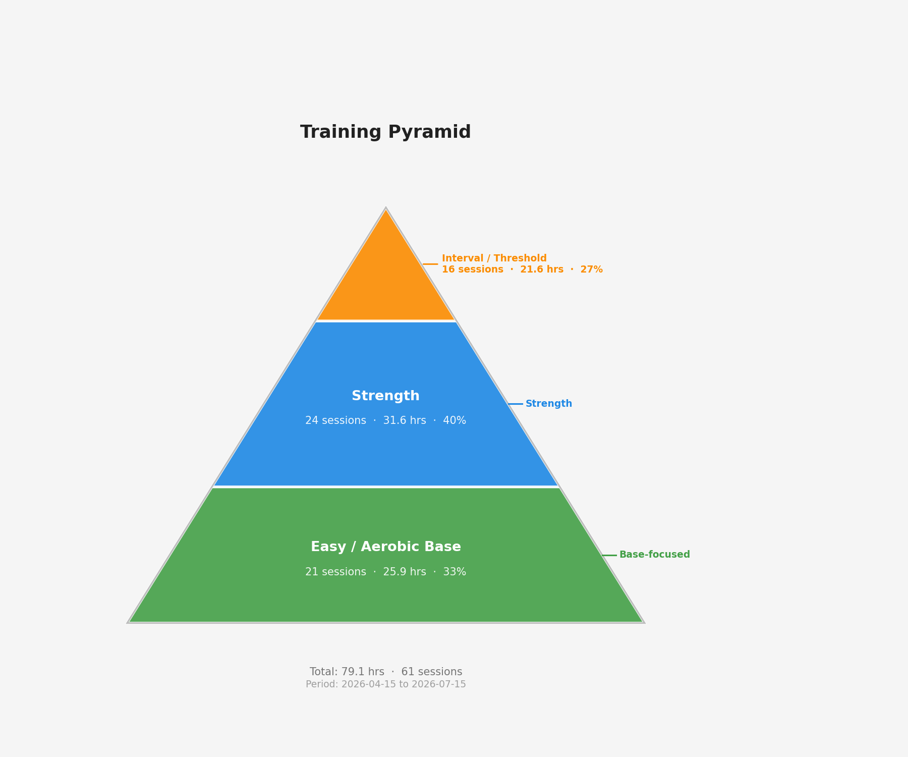
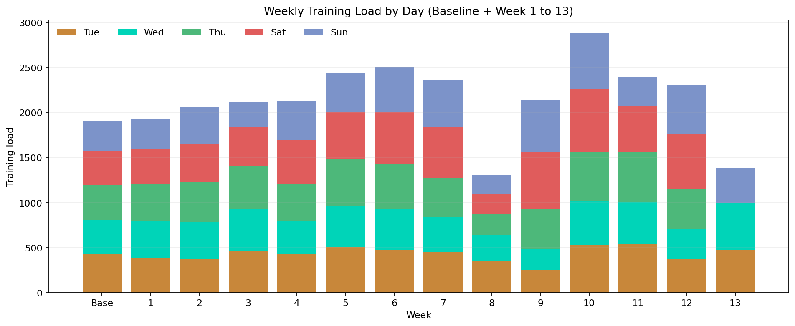
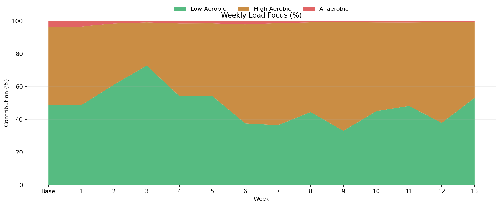
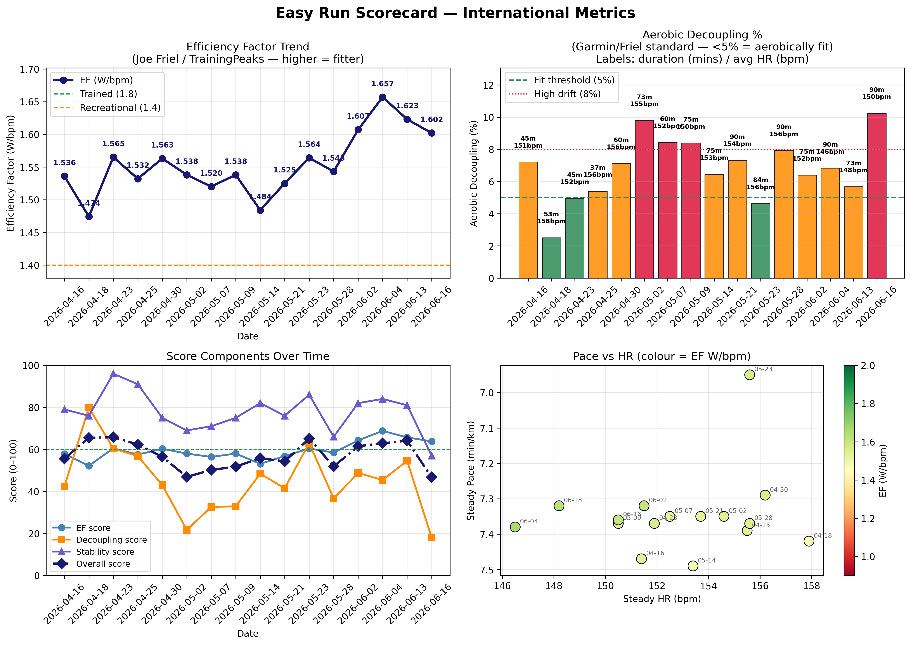
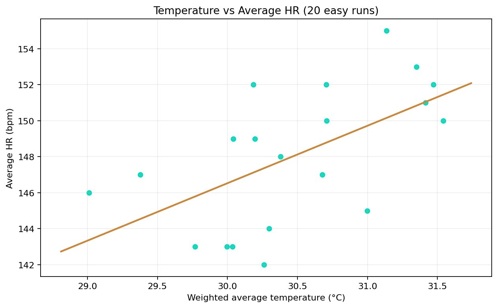
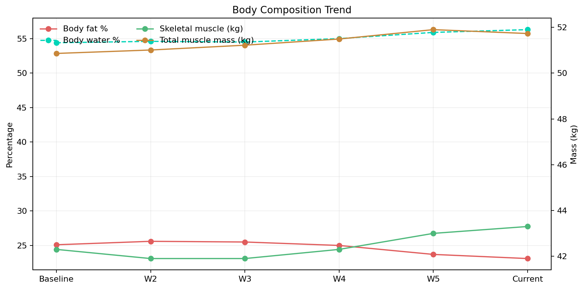
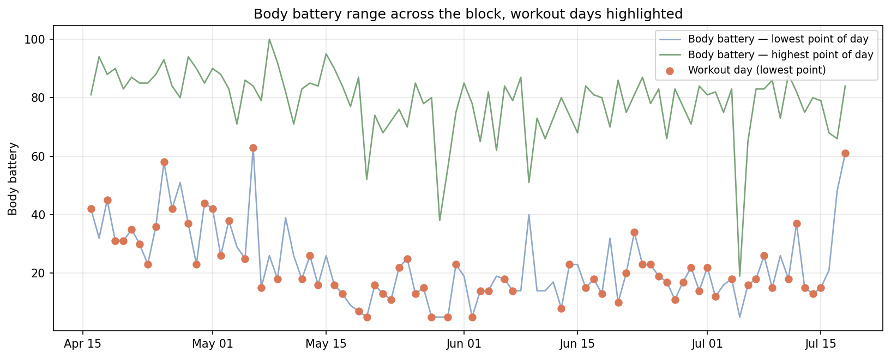
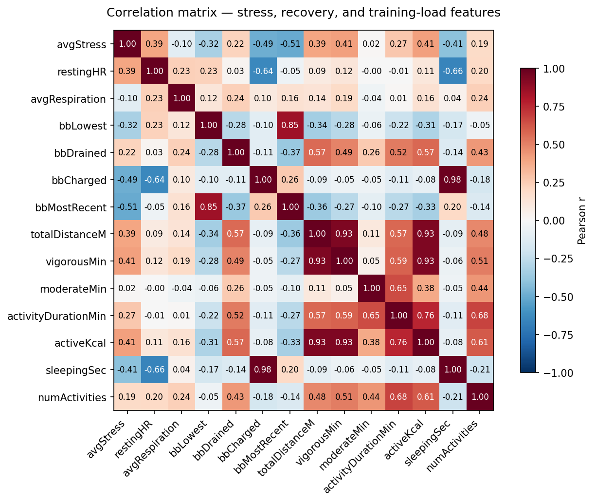

# The Heart Doesn't Lie

> Source: Personal running research article, “Ran 21 Easy Runs in the Chennai Heat. Here's what the data actually showed.”
> Training block: 14 April to 18 July 2026.
> This Markdown version is intended as the research/documentation source for the `theEagle` repository.

::: hero
Running Science · Personal Data · 13-Week Analysis

# Ran 21 Easy Runs in the Chennai Heat. *Here\'s what the data actually showed.*

A personal experiment tracking my fitness, my running form, and how
training in 30°C heat affects my body - measured the HR beat by beat.

Personal N=1 observation as a recreational runner; these values may not
apply to everyone.

::: breath-wrap
::: breath-wave-holder
:::
:::
:::

There was one thing that kept bothering me during this training block.
No matter how easy the run was supposed to be, my heart rate always
found a way to climb and be noisy in the majority of the runs. Every
time it happened, the explanation was like ready made! Heat\...
Humidity\... or Salty air\... etc I accepted those answers for long time
until I finally looked at the data.

Between April and July, I completed 21 easy runs during this training
block. Garmin classified every one of them as an Aerobic Base run. I
kept the pace stayed almost for every run, and the effort was meant to
be easy throughout. So one question kept coming back to me. If I was
running at nearly the same pace with the same training purpose, why was
my average heart rate different almost every day?

Everything looks good\... until the charts show the real story.

::: callout
::: stat-item
[21]{.stat-num} [Easy runs analyzed]{.stat-label}

Apr 16 -- Jul 18, 2026
:::

::: stat-item
[+6.9%]{.stat-num} [Aerobic efficiency gain]{.stat-label}

Power per heartbeat (W/bpm)
:::

::: stat-item
[18/21]{.stat-num} [Runs at 30°C or hotter]{.stat-label}

The Chennai heat factor
:::
:::

## Progress snapshot: April to July

::: chart-wrap
[Key metrics]{.metrics-badge}

Key training and body changes

::: metrics-table-wrap
  Metric                   April (Approx.)   Current (July)   Change                             Interpretation
  ------------------------ ----------------- ---------------- ---------------------------------- --------------------------------------------
  VO₂ Max                  45                50               +5 (+11.1%)                        Improved aerobic fitness
  Efficiency Factor (EF)   1.536 W/bpm       1.642 W/bpm      +6.9%                              Significant aerobic efficiency improvement
  Aerobic Decoupling       Frequently \>8%   Median 7.1%      Improving but still above target   Endurance base still developing
  Average Easy HR          \~155 bpm         \~143 bpm        −12 bpm                            Strong cardiovascular adaptation
  Body Fat %               25.10%            23.10%           −2.00%                             Positive body recomposition
  Body Weight              74.85 kg          72.15 kg         −2.70 kg                           Leaner while maintaining muscle
  BMI                      24.10             23.80            −0.30                              Improved body composition ratio
  Muscle Rate              71.20%            71.70%           +0.50%                             Higher lean mass percentage
  Skeletal Muscle          42.30 kg          43.30 kg         +1.00 kg                           Functional muscle increase
  Muscle Mass              51.90 kg          51.73 kg         −0.17 kg                           Slight fluctuation, net positive
  Body Water               55.90%            56.30%           +0.40%                             Better hydration status
  Protein Mass             15.30 kg          15.40 kg         +0.10 kg                           Supports muscle quality
  Subcutaneous Fat         17.00%            16.50%           −0.50%                             Reduction in surface body fat
  Visceral Fat             6                 6                Stable                             Healthy internal fat level
  BMR                      1570 kcal         1567 kcal        −3 kcal                            Negligible change
:::

Top 5 are visible by default.
:::

::: {style="margin: 3rem -24px; padding: 18px 32px; background: var(--surface); border-top: 1px solid var(--ink-faint); border-bottom: 1px solid var(--ink-faint); display: flex; align-items: center; justify-content: space-between; gap: 24px; flex-wrap: wrap;"}
::: {style="font-size: 10px; font-weight: 700; letter-spacing: 0.2em; text-transform: uppercase; color: var(--amber); white-space: nowrap;"}
Coached by
:::

[Gokul Prasad
PB](https://www.linkedin.com/in/gokul-prasad-pb-lt-commander-in-data-center-practitioner-73562930/){rel="noopener"
style="font-family: var(--serif); font-size: 24px; font-weight: 400; color: var(--ink); text-decoration: none; flex: 1; text-align: center; white-space: nowrap;"
target="_blank"}

::: {style="font-size: 12px; color: var(--ink-muted); text-align: right; white-space: nowrap; line-height: 1.6;"}
Lt Commander, Indian Navy\
TTK Coach
:::
:::

## Training Background: the big picture

There is something called a training pyramid. Think of it as a quick way
to see whether the foundation of your training is strong enough to
support the harder sessions.

Official training block lasted 96 days, from 14 April to 18 July.
Already I have done a couple of weeks of training before it started. The
only break came when I had a fever and had to take three days off. Other
than that, plan is followed consistently.

::: chart-wrap
Training pyramid - Apr 14 to Jul 18

::: {.pyramid-fade-in style="padding-top: 8px; text-align: center;"}

:::
:::

Strength training took the biggest share of my training time at 40%.
That was something I never expected. It simply happened just like that,
and each strength session lasted between one and two hours. Looking
back, the easy runs often felt much harder than I imagined. There were
days when even a 30 minute easy run felt tougher than a one hour
strength session. Sometimes, I would already feel tired before even I
started running.

### Weekly training load, day by day

Each day of the week had a specific purpose in this training block.
Tuesday was for speed or threshold work. Wednesday and Sunday were
strength days. Thursday was for easy runs, and Saturday was reserved for
a long run or a tempo session. Most TTians would already know this
routine.

As the training block reached the halfway point, the workouts became
more challenging each week. Coach usually shared the next week\'s plan
on Sunday evening or Monday afternoon. Waiting for that message became a
feeling that is hard to explain. There was a little nervousness because
I wasn\'t always sure I could finish what was planned or not.

::: chart-wrap
Weekly training load by day - Baseline + Week 1 to 13

::: {style="display:flex; gap:14px; margin-bottom:14px; flex-wrap:wrap;"}
[[]{style="width:10px;height:10px;border-radius:2px;background:#C8873A;display:inline-block;"}Tue
·
Speed/Threshold]{style="display:flex;align-items:center;gap:6px;font-size:12px;color:#9A9082;"}
[[]{style="width:10px;height:10px;border-radius:2px;background:#00D4B8;display:inline-block;"}Wed
·
Strength]{style="display:flex;align-items:center;gap:6px;font-size:12px;color:#9A9082;"}
[[]{style="width:10px;height:10px;border-radius:2px;background:#4DB87A;display:inline-block;"}Thu
· Easy
Aerobic]{style="display:flex;align-items:center;gap:6px;font-size:12px;color:#9A9082;"}
[[]{style="width:10px;height:10px;border-radius:2px;background:#E05C5C;display:inline-block;"}Sat
·
Long/Tempo]{style="display:flex;align-items:center;gap:6px;font-size:12px;color:#9A9082;"}
[[]{style="width:10px;height:10px;border-radius:2px;background:#7C93C9;display:inline-block;"}Sun
·
Strength]{style="display:flex;align-items:center;gap:6px;font-size:12px;color:#9A9082;"}
:::

::: {.chart-canvas-wrap style="height:300px;"}

:::

::: {style="display:flex; gap:10px; flex-wrap:wrap; margin-top:16px;"}
:::
:::

::: {#weeklyLoadTableWrap .metrics-table-wrap style="margin-top:1.5rem; display:none;"}
  Week       Dates            Tue   Wed   Thu    Sat    Sun   Total
  ---------- ---------------- ----- ----- ------ ------ ----- -------
  Baseline   13--19 Apr       427   381   388    375    337   1908
  1          20--26 Apr       385   406   418    383    334   1926
  2          27 Apr--03 May   377   409   447    419    405   2057
  3          04--10 May       460   463   484    429    287   2123
  4          11--17 May       429   370   407    485    440   2131
  5          18--24 May       502   464   517    522    437   2442
  6          25--31 May       474   451   502    574    499   2500
  7          01--07 Jun       449   389   436    562    522   2358
  8          08--14 Jun       350   288   228    226    218   1310
  9          15--21 Jun       247   239   441    637    575   2139
  10         22--28 Jun       530   492   544    701    617   2884
  11         29 Jun--05 Jul   534   469   556    511    332   2402
  12         06--12 Jul       367   340   446    607    544   2304
  13         13--19 Jul       477   522   REST   REST   383   1382
:::

::: {#loadFocusSection .chart-wrap style="margin-top:1.5rem; display:none;"}
Weekly load focus - Baseline + Week 1 to 13

::: {style="display:flex; gap:14px; margin-bottom:14px; flex-wrap:wrap;"}
[[]{style="width:10px;height:10px;border-radius:2px;background:#4DB87A;display:inline-block;"}Low
Aerobic]{style="display:flex;align-items:center;gap:6px;font-size:12px;color:#9A9082;"}
[[]{style="width:10px;height:10px;border-radius:2px;background:#C8873A;display:inline-block;"}High
Aerobic]{style="display:flex;align-items:center;gap:6px;font-size:12px;color:#9A9082;"}
[[]{style="width:10px;height:10px;border-radius:2px;background:#E05C5C;display:inline-block;"}Anaerobic]{style="display:flex;align-items:center;gap:6px;font-size:12px;color:#9A9082;"}
:::

::: {.chart-canvas-wrap style="height:300px;"}

:::

::: {.metrics-table-wrap style="margin-top:1.5rem;"}
  Week       Dates            Low Aerobic   High Aerobic   Anaerobic
  ---------- ---------------- ------------- -------------- -----------
  Baseline   13--19 Apr       652           645            46
  1          20--26 Apr       652           645            46
  2          27 Apr--03 May   902           551            23
  3          04--10 May       1036          376            12
  4          11--17 May       850           697            24
  5          18--24 May       893           729            24
  6          25--31 May       652           1048           37
  7          01--07 Jun       660           1129           24
  8          08--14 Jun       655           808            12
  9          15--21 Jun       523           1052           12
  10         22--28 Jun       733           885            14
  11         29 Jun--05 Jul   753           796            14
  12         06--12 Jul       717           1166           14
  13         13--19 Jul       884           770            14
:::

The training focus changed as the weeks went by. The early weeks were
mostly easy aerobic running. As race day came closer, tempo and
threshold sessions became more common, so High Aerobic started
contributing more than Low Aerobic. Anaerobic work stayed small
throughout the block and reduced further during the final tape
:::

Week 1, from 20 to 26 April, marks the start of this training block. I
kept the previous week only as a baseline so I could compare how the
training progressed. Week 8 was different. I came down with a fever, and
Coach asked me to take a few days off. I missed the Tuesday, Wednesday,
and Thursday workouts, and you can clearly see the drop in training
load. The weekly load fell to 1310, the lowest of the entire block. The
following week, I was back to training as usual. By Week 10, the weekly
load reached its highest point at 2884, helped by a 16 km tempo run on
Saturday. Week 13 was the taper week. It included a 90 minute easy run
on Tuesday, a shorter 5 × 800 m interval session on Wednesday, Thursday
and Friday completely off, and a short 30 minute tempo run on Saturday
to stay sharp before race day.

The Load Focus chart tells its own story. During the first half of the
training block, most of the load came from easy runs. In the second
half, full of tempo and threshold sessions.

*Note: Up to 31 May, Tuesdays were dedicated to interval/tempo workouts
and Thursdays to easy aerobic runs. From 1 June onward, this pattern was
reversed, with Tuesdays becoming easy runs and Thursdays becoming the
primary interval/threshold workout. Charts can be interprested
accordingly

Source: [DRHM 2026 Performance
Tracker](https://docs.google.com/spreadsheets/d/1EMRGG6NvOwmLqFuWzaR4VSWpw7U0bds4Hmn0_BqESoE/edit){rel="noopener"
style="color:var(--cyan);" target="_blank"}, Daily/Weekly logging on
performance metric manually .

## The metric that matters: Its efficiency, not the pace

Like many runners, I always thought pace was the best way to measure
fitness. If my pace got faster, I felt I was getting fitter. I spent a
lot of time looking at pace, heart rate, and other charts, but hardly
paid any attention to the power metrics. Even on the Garmin activity
screen, the power chart appears near the bottom, making it easy to
overlook. As I spent more time exploring my running data, I realized
this was one of the metrics that deserved much more attention.

Efficiency Factor measures how many watts I produce for every heartbeat.
In simple terms, it tells me how much running power I generate for the
effort my heart is putting in.

**Efficiency Factor = Average Power ÷ Average Heart Rate**

::: {#efFormulaDetail style="display:none; margin-top:-0.75rem; margin-bottom:1rem;"}
For example:\
\
Average Power = 230 W\
Average Heart Rate = 150 bpm\
\
Efficiency Factor = 230 ÷ 150 = 1.53 W/bpm
:::

The higher the Efficiency Factor, the more running power I am producing
for each heartbeat. I found this to be a much better way to understand
how efficiently my body was working than looking at pace alone.

Efficiency Factor went from 1.536 W/bpm on my first run to 1.642 W/bpm
on my most recent one. That\'s a 6.9% improvement in true aerobic
fitness over 13 weeks of training. For a better understanding, a score
below 1.4 usually means a beginner, and above 1.8 usually means a
well-trained runner. I\'m in the middle of the range for a regular
recreational runner.

::: chart-wrap
Efficiency Factor (W/bpm) across 21 easy runs

::: {.chart-canvas-wrap style="height:350px;"}

:::

Chart data source:
[hr_improvement_analysis.csv](https://github.com/jvinodraj/theEagle/blob/master/reports/easy/hr_improvement_analysis.csv){rel="noopener"
style="color:var(--cyan);" target="_blank"}.
:::

For all my easy runs, I stayed close to the same pace of around 7:20 /km
throughout the training block, irrespective to the training load. Even
as the weekly training load increased, I found that my body was handling
the effort better.

## The problem I can\'t explain away: Aerobic Decoupling

Here\'s another metric I couldn\'t ignore. Aerobic Decoupling(Heart Rate
Drift) measures how much your heart rate changes while maintaining a
steady aerobic effort. In simple terms, it compares how efficiently you
ran during the second half of the run when compared to the first half,
after excluding the warm up.

As a general guideline, a value below 5% suggests you were able to
maintain the same aerobic effort throughout the run. Values between 5%
and 8% are generally considered acceptable but may indicate there is
still room for improvement. Values above 8% suggest your heart rate
drifted more than expected for the same effort. My median value across
the 21 easy runs was 7.1%, and only 3 of those runs stayed below the 5%
mark.

> \"Seven of twenty-one runs crossed the 8% line - the strongest
> within-run fatigue signal in these sessions.\"

::: {.callout .amber}
::: stat-item
[7.1%]{.stat-num} [Median aerobic decoupling]{.stat-label}

Benchmark: \<5% per run
:::

::: stat-item
[3/21]{.stat-num} [Runs below 5% threshold]{.stat-label}

14% pass rate
:::

::: stat-item
[7/21]{.stat-num} [Runs above 8% - high fatigue signal]{.stat-label}

Including the last two
:::
:::

But there\'s an important factor to consider: **18 of my 21 runs
happened at 30°C or hotter**. Heat alone pushes your heart rate up
during a run, no matter how fit you are. So it\'s hard to know how much
of my decoupling is caused by heat and how much by fatigue. Probably
both\... The latest run (July 14) also came in at 8.4%, which suggests
fatigue is still present.

So I compared each run\'s weighted average temperature against its
average heart rate. The pattern was very clear.

::: chart-wrap
Temperature vs average HR - 20 easy runs (weighted avg °C)

Notebook used for this analysis:
[easy_run_daily_hr_smoothness.ipynb](https://github.com/jvinodraj/theEagle/blob/master/notebooks/easy_run_daily_hr_smoothness.ipynb){rel="noopener"
style="color:var(--cyan);" target="_blank"}.

::: {style="display:flex; gap:16px; margin-bottom:14px; flex-wrap:wrap;"}
[[]{style="width:10px;height:10px;border-radius:50%;background:#00D4B8;display:inline-block;"}Easy
run]{style="display:flex;align-items:center;gap:6px;font-size:12px;color:#9A9082;"}
[[]{style="width:22px;height:2px;background:#C8873A;display:inline-block;"}Fit:
HR = 3.19×Temp +
50.7]{style="display:flex;align-items:center;gap:6px;font-size:12px;color:#9A9082;"}
:::

::: {.chart-canvas-wrap style="height:280px;"}

:::
:::

Each extra degree Celsius adds roughly **3.2 beats per minute** to my
heart rate.[ The formula is HR = 3.19 × temperature + 50.7, and
temperature alone explains most of the difference in heart rate between
my runs. In practical terms: a run at 31.5°C puts about 8 more beats per
minute of strain on my heart than a run at 29°C before fatigue, fitness,
or pace are even considered.]{#tempFormulaDetail .inline-detail}

Two runs stand out. On **July 14** (30.3°C, 142 bpm), my heart rate came
in about **5 bpm lower than temperature alone would predict**. This was
the strongest sign of adaptation in the whole dataset, right at the end
of the block. On **April 30** (30.2°C, 152 bpm), heart rate ran nearly
**5 bpm higher than predicted**, the largest positive miss, early on
before the heat adaptation had set in.

::: {.callout .amber}
::: stat-item
[\~3.2]{.stat-num} [BPM cost per °C of heat]{.stat-label}

Linear regression, 20 runs with temperature data (r = 0.58, p = 0.0074).
One run failed to record temperature
:::

::: stat-item
[−12 bpm]{.stat-num} [HR drop: Apr 18 → Jun 23]{.stat-label}

155 → 143, similar distance
:::

::: stat-item
[29--31.5°C]{.stat-num} [Temperature range across sessions]{.stat-label}

\~7 bpm spread from heat alone
:::
:::

This means comparing heart rate or Efficiency Factor between runs
without accounting for temperature can be misleading. A heart rate of
148 bpm at 29°C is a very different effort than 148 bpm at 32°C.
Adjusting Efficiency Factor for heat is the more accurate way to track
progress here and even after making that adjustment, my trend still
points upward.

## Week by week: how my body adapted

Looking at weekly averages instead of single runs shows the pattern more
clearly, good weeks followed by harder weeks, where the body seems to be
recovering and rebuilding before the next gain shows up.

::: week-labels
[Base]{.week-label} [W1]{.week-label} [W2]{.week-label}
[W3]{.week-label} [W4]{.week-label} [W5]{.week-label} [W6]{.week-label}
[W7]{.week-label} [W8]{.week-label} [W9]{.week-label} [W10]{.week-label}
[W11]{.week-label} [W12]{.week-label} [W13]{.week-label}
:::

::: {#weekBand .week-band}
:::

::: {#runTimeline style="margin: 1.5rem 0 2.5rem;"}
:::

Weeks 2, 3, and 4 (early-to-mid May) were high fatigue weeks. Then weeks
7 and 8 showed the best results of the block. Efficiency Factor at 1.63,
decoupling under 7%. Weeks 9 and 10 slipped back toward higher fatigue,
weeks 11 and 12 stabilized, and week 13 moved back into fatigue risk. A
recovery week is still overdue.

## Intervals and threshold: going harder

Easy runs are only part of the story. Alongside them, I ran 17 interval
and threshold sessions, and both the volume and intensity of these
sessions have been increasing.

::: {.callout .green}
::: stat-item
[17]{.stat-num} [Interval / threshold sessions]{.stat-label}

Apr 14 -- Jul 18
:::

::: stat-item
[5.0]{.stat-num} [Peak aerobic training effect]{.stat-label}

June 27
:::

::: stat-item
[1,893s]{.stat-num} [Time near threshold (June 27)]{.stat-label}

Best of the entire block
:::
:::

A deeper, rep-level diagnostic for these sessions is in progress.[ It\'s
a composite score that normalizes power, cardiac drift, recovery drop,
and pace on a 0--1 scale, so sessions can be compared apples-to-apples.
Validated on one session so far; running it across all 17 is still to
come. Methodology so far: the [notebook is on
GitHub](https://github.com/jvinodraj/theEagle/blob/master/notebooks/interval_training_diagnostics.ipynb){rel="noopener"
style="color:var(--cyan);" target="_blank"}.]{#intervalDiagDetail
.inline-detail}

## Strengthening, and whether it helped

Alongside the running, I completed 24 strength sessions, averaging about
two sessions each week. Most of them laster for atleast 1.5 hours.

One limitation is that all my strength sessions were bodyweight
exercises. Since I wasn\'t lifting weights, it was hard to measure or
track. Even so, the average recovery cost was 59.4 out of 100, which is
in the moderate range, and none of the sessions reached a high fatigue
level. Overall, the strength sessions worked well alongside my running.

## The body itself: composition over 10 weeks

Running and bodyweight training changed more than just my weight. My
face became noticeably leaner, but the weighing scale told only part of
the story. I lost 2.70 kg during this training block. The real question
was whether I had lost fat, muscle, or a bit of both. That\'s where the
body composition data became much more interesting.

::: {.callout .green}
::: stat-item
[−2.00%]{.stat-num style="color: var(--green);"} [Body fat change
(baseline to current)]{.stat-label}

25.10% → 23.10%
:::

::: stat-item
[+1.00 kg]{.stat-num style="color: var(--green);"} [Skeletal muscle
gained]{.stat-label}

42.30 → 43.30 kg
:::

::: stat-item
[+1.90%]{.stat-num style="color: var(--cyan);"} [Body water
increase]{.stat-label}

54.40% → 56.30%
:::
:::

Across six body composition measurements, the changes followed a clear
pattern. One thing I kept hearing was, \"Too much running will make you
skinny,\" or \"You\'ll lose muscle\". After all, its only running around
42 km weekly mileage max along with bodyweight strength training. So I
wanted to know what I was actually losing. The body composition data
answered that question. Body fat steadily came down, while skeletal
muscle, muscle rate, protein mass, and body water all increased. Looking
at these changes together, it was encouraging to see that my running,
bodyweight strength training, nutrition, and recovery were working well
together.

::: chart-wrap
Body composition trend - 6 measurements over time

::: {style="display:flex; gap:8px; margin-bottom:16px; flex-wrap:wrap;"}
[[]{style="width:10px;height:3px;background:#E05C5C;display:inline-block;border-radius:2px;"}Body
fat %
(−2.00%)]{style="display:flex;align-items:center;gap:6px;font-size:12px;color:#9A9082;"}
[[]{style="width:10px;height:3px;background:#4DB87A;display:inline-block;border-radius:2px;"}Skeletal
muscle (kg) (+1.00
kg)]{style="display:flex;align-items:center;gap:6px;font-size:12px;color:#9A9082;"}
[[]{style="width:10px;height:3px;background:#C8873A;display:inline-block;border-radius:2px;"}Total
muscle mass (kg) (+0.87
kg)]{style="display:flex;align-items:center;gap:6px;font-size:12px;color:#9A9082;"}
[[]{style="width:10px;height:3px;background:#00D4B8;display:inline-block;border-radius:2px;border-style:dashed;"}Body
water %
(+1.90%)]{style="display:flex;align-items:center;gap:6px;font-size:12px;color:#9A9082;"}
:::

::: chart-canvas-wrap

:::
:::

::: {#bodyCompTable style="overflow-x:auto; margin:2rem 0; background:var(--surface); border:1px solid var(--ink-faint); border-radius:10px; padding:20px; display:none;"}
  Metric                  Baseline    W2      W3      W4      W5     Current   Change
  ---------------------- ---------- ------- ------- ------- ------- --------- --------
  Body Weight (kg)         74.85     73.50   73.80   73.55   72.90    72.15    −2.70
  BMI                      24.30     24.30   24.40   24.30   24.10    23.80    −0.50
  Body Fat %               25.10     25.60   25.50   25.00   23.70    23.10    −2.00%
  Muscle Rate %            69.20     69.40   69.40   70.00   71.20    71.70    +2.50%
  Body Water %             54.40     54.60   54.50   55.00   55.90    56.30    +1.90%
  Protein Mass (kg)        14.80     14.90   14.90   15.00   15.30    15.40    +0.60
  Muscle Mass (kg)         50.86     51.01   51.22   51.49   51.90    51.73    +0.87
  Skeletal Muscle (kg)     42.30     41.90   41.90   42.30   43.00    43.30    +1.00
  Subcutaneous Fat %       18.40     18.30   18.20   17.90   17.00    16.50    −1.90%
  Visceral Fat               7         7       7       7       6        6        −1
  BMR (kcal)                1547     1551    1555    1561    1570     1567      +20
:::

Protein mass is now at 15.40 kg (+0.60 kg from baseline), and body water
at 56.30% (+1.90%). Both are strong indicators of muscle quality and
hydration status. The skeletal muscle increase of +1.00 kg from baseline
shows sustained, functional muscle development. Body fat at 23.10%
(−2.00% from 25.10%) represents the cleanest recomposition: fat loss
paired with lean mass gain.

One thing to keep in mind is that these are only six body composition
measurements, not years of data. Home body composition scales are not
perfectly accurate to be considered, so small changes from one week to
the next should not be overinterpreted. keep it light and low

## Most interesting findings from wellness and recovery signals

### 1. Resting HR improved meaningfully across the period

::: {.callout .green}
::: stat-item
[65.0 bpm]{.stat-num} [First 14 wellness days average]{.stat-label}
:::

::: stat-item
[59.2 bpm]{.stat-num} [Last 14 wellness days average]{.stat-label}
:::

::: stat-item
[−5.8 bpm]{.stat-num} [Net change]{.stat-label}

10-day low-RHR streak (≤55 bpm): May 14--May 23
:::
:::

### 2. Stress spiked in June, then eased through early July

::: chart-wrap
Monthly average stress

::: {style="padding-top: 6px;"}
::: data-row
[April]{.data-row-label} [22.3]{.data-row-val}
[baseline]{.data-row-delta .flat}
:::

::: data-row
[May]{.data-row-label} [28.4]{.data-row-val} [+6.1]{.data-row-delta .up}
:::

::: data-row
[June]{.data-row-label} [43.9]{.data-row-val} [+15.5]{.data-row-delta
.up}
:::

::: data-row
[July (Jul 1--18, 18 wellness days)]{.data-row-label}
[35.4]{.data-row-val} [−8.5]{.data-row-delta .down}
:::
:::
:::

June 9 recorded the highest stress levels of the entire training block
(average 82, maximum 97), despite almost no activity (608 steps, 0.48
km). This occurred during Week 8, when illness forced me to stop
training, illustrating how physiological stress remained elevated even
as physical activity dropped to its lowest level.

An expanded pull of the stress dataset (94 daily readings, April 16
through July 18, the full window covered by the raw Garmin export)
confirms the June spike was a peak, not a new normal: July has averaged
35.4, back below June\'s 43.9 and closer to the April--May range. Across
the full window, mean stress sits at 33.7 (median 32), with 27.7% of
days landing in the high-stress band and 25.5% landing low, a wide
spread, but one that\'s trending back down.

### 3. A very strong recovery block happened in mid-May

The lowest resting heart rates were recorded between **May 14 and May
19**, reaching a minimum of **44 bpm**. HRV data were available for only
**11 days**, as I did not wear my watch during sleep on most nights.
During the period with available data, HRV averaged **62.5 ms** and
peaked at **69 ms**. Combined with the sustained low resting heart rate,
this suggests a brief period of excellent recovery and physiological
readiness.

::: {.callout .amber .callout-single}
::: stat-item
[2026-05-20]{.stat-num} [Largest fatigue-like day]{.stat-label}

Sleep: 3.75 h · Body Battery recent: 5 · Sleep-need delta: +40 min
:::
:::

### 4. High-load days often line up with higher stress strain - but not always

Big activity days included June 18, June 20, June 27, and July 4, with
top-day volume around 18 to 19.5 km. June 20 is the clearest pairing of
the two signals: high volume alongside Medium-band stress (average 65).

## Breaking the 101 days into phases

These 101 days were not one smooth trend. They break into clear phases,
where training load, sleep, stress, and Body Battery each tell a
different part of the story.

One thing worth explaining before the charts: this section leans on
**peak Body Battery** rather than the **most-recent reading**. Garmin\'s
snapshot has 100s of parameters, out of which for Body Battery, there
are four ways to look at recovery for a given day, and each answers a
slightly different question. The daily peak Body Battery is better
reflects how completely my body recovered overnight, making it a more
meaningful measure of recovery across the training block.

::: {#bbMetricTableWrap .metrics-table-wrap style="margin-top:1.5rem; display:none;"}
  Metric                                    Question                                                   Use case
  ----------------------------------------- ---------------------------------------------------------- ---------------------------------------------------------------------------------
  `bb_high` (peak battery)                  How much recovery capacity did I achieve despite stress?   Best for recovery resilience - shows if stress limited peak recovery potential.
  `bb_most_recent` (end of day)             How depleted am I at day\'s end vs. daily stress?          Current approach elsewhere in the article - shows cumulative depletion.
  `bb_at_wake` (wake value)                 What\'s the starting point for the day?                    Context only.
  `bb_high − bb_at_wake` (net daily gain)   How much did I recover during the day vs. stress?          Best for net recovery - shows actual recovery accomplished.
:::

::: chart-wrap
Garmin stress vs peak body battery daily trend (Apr 16 to Jul 18)

Notebook used for this analysis:
[garmin_stress_body_battery_trend.ipynb](https://github.com/jvinodraj/theEagle/blob/master/notebooks/garmin_stress_body_battery_trend.ipynb){rel="noopener"
style="color:var(--cyan);" target="_blank"}.

::: {.chart-canvas-wrap style="height: 300px;"}

:::
:::

::: chart-wrap
Stress vs peak body battery scatter with linear fit

::: {.chart-canvas-wrap style="height: 300px;"}

:::
:::

Switching to **daily peak** Body Battery (the highest reading logged
each day, usually reached overnight) changes the picture. The
relationship is still inverse, but much weaker.[ The fitted line is
**Peak Body Battery = -0.19 × Stress + 85.0**, with a correlation of
only r = −0.23 (p = 0.03) across the 94 days with complete data. That
makes sense\... A day\'s peak is set mostly by how well the previous
night\'s recovery went, so it is far less sensitive to that day\'s
stress than a same-day \"most recent\" reading is.]{#bbFitDetail
.inline-detail}

::: {.chart-wrap style="display:none;"}
Phase map (activity + resting HR + stress + body battery)

Each line is the raw daily value in its own native units: resting HR
(bpm), stress, and peak Body Battery are all plotted on a shared 0--100
left axis (resting HR fits comfortably in that range). Activity is shown
as bars (daily distance in km, right axis) only for Tuesday, Thursday,
and Saturday - the scheduled running days - with no bar on other days.
Shaded bands mark the four phases below.

::: {.chart-canvas-wrap style="height: 320px;"}
:::

::: {style="padding-top: 20px;"}
::: data-row
[Phase 1: Baseline build (Apr 16 to May 13)]{.data-row-label}
[Stabilizing]{.data-row-val} [mixed stress]{.data-row-delta .flat}
:::

::: data-row
[Phase 2: Recovery crest (May 14 to May 23)]{.data-row-label} [Best
recovery]{.data-row-val} [low RHR]{.data-row-delta .up}
:::

::: data-row
[Phase 3: Strain ramp (late May through June)]{.data-row-label} [Load
accumulation]{.data-row-val} [stress jump]{.data-row-delta .up}
:::

::: data-row
[Phase 4: High-load edge (Jul 1 to Jul 18)]{.data-row-label}
[Performance]{.data-row-val} [dip then rebound]{.data-row-delta .flat}
:::
:::
:::

::: {style="display:none;"}
**Phase 1: Baseline build.** This was the beginning of the training
block. Body was slowly getting used to the initial training block.
Resting heart rate was a little higher, and recovery hadn\'t settled
into a consistent pattern yet.

**Phase 2: Recovery crest.** This is the cleanest autonomic window in
the dataset: low-RHR streak (10 days at 55 bpm or below), lowest daily
resting HR near 44 bpm, and the strongest short HRV window (average
around 62.5, peak 69). This is the reference pattern for what
\"absorbing training\" looks like in your data.

**Phase 3: Strain ramp.** June stress rises sharply (43.9 monthly
average vs 28.4 in May), while volume and quality work continue. The
June 9 outlier (average stress 82, max 97, minimal movement) suggests at
least part of the load is systemic rather than purely mechanical.

**Phase 4: High-load edge.** Early July opens calm - stress eases off
the June highs, and a corrected reading for July 4 (34, not the
originally logged 80) confirms the strain phase is resolving. But the
window through July 18 is not a clean cooldown. July 5 shows the lowest
peak Body Battery in the entire 94-day dataset (19, versus a next-lowest
of 38 on May 29) - an outlier worth flagging rather than reading as a
trend. Peak Body Battery holds in the 70s through mid-July, dips again
around July 10, then rebounds to 80--88 by July 12--13. Stress follows a
similar up-and-down: it eases to a monthly low near 22--25 mid-month
before a sharp single-day spike on July 14 (66, tied for the
second-highest reading in the dataset) pulls the 7-day average back up
to 39.4 by July 15. The last two days don\'t resolve the picture
either - stress eases back to 27 on July 17, then jumps to 46 on July
18, with Body Battery bouncing along the same way (66, then 84). Taken
together, this reads less like a steady cooldown and more like a system
oscillating around a new, lower baseline - still absorbing load overall,
but with less margin for a bad day than the mid-May recovery crest had.

> In this window, the key pattern is a recovery-led peak in mid-May, a
> stress-dominant phase in June, and a choppier early-to-mid-July
> stretch - an initial cooldown, an isolated Body Battery outlier, and a
> mid-month stress spike - even as training volume stays high. The same
> training load gets more expensive when non-training stress climbs, and
> cheaper again once it recedes, but by mid-July that recovery margin is
> thinner than it was during May\'s recovery crest.
:::

## Data quality caveats

::: {.callout .red .callout-single}
::: stat-item
[5 days]{.stat-num} [Missing wellness metrics]{.stat-label}

Apr 11--Apr 15
:::
:::

The most reliable health trend window is effectively April 16 to July
18, 2026, for resting heart rate, stress, and Body Battery. based on a
single consolidated pull from the raw Garmin export covering all 94 days
in that span, and one that also confirms a corrected reading for July 4
(originally logged as 80, actually 34). HRV and full sleep-stage data
are the exception: they\'re only present for a short subset (11 days,
mostly in May and early June), so long-range conclusions for HRV and
sleep staging should still be treated as directional rather than
definitive.

## The People Behind the Numbers

::: {.callout .green}
::: stat-item
[6.9%]{.stat-num} [EF improvement]{.stat-label}

1.536 → 1.642 W/bpm
:::

::: stat-item
[79.6 hrs]{.stat-num} [Total training volume]{.stat-label}

62 sessions across 13 weeks
:::

::: stat-item
[−5.8 bpm]{.stat-num} [Resting HR trend]{.stat-label}

65.0 → 59.2 bpm
:::
:::

Over 13 weeks and 79.6 hours of training, one thing became clear. My
aerobic fitness improved. Efficiency Factor increased from 1.536 to
1.642 W/bpm, and my resting heart rate came down by nearly 6 beats per
minute. These are not huge changes, but they show what consistent
training can do over time.

The journey was not perfect. I had a fever in June, stress levels went
up, and recovery was not always smooth. The charts show both the good
days and the difficult ones. Looking back, I\'m glad they do, because
that\'s what a real training block looks like.

None of this happened by myself. TTK Coach [Gokul Prasad
PB](https://www.strava.com/athletes/18289180){rel="noopener"
style="color:var(--cyan);" target="_blank"} planned every stage of this
training block, from the easy weeks to the harder sessions and the taper
before race day. Special thanks to
[Subbu](https://www.strava.com/athletes/128763784){style="color:var(--cyan);"},
[Jo](https://www.strava.com/athletes/158837133){style="color:var(--cyan);"},
[Vasi](https://www.strava.com/athletes/164430974){style="color:var(--cyan);"},
[Vinodh
Kumar](https://www.strava.com/athletes/50210189){style="color:var(--cyan);"},
[Murugesan](https://www.strava.com/athletes/189756479){style="color:var(--cyan);"},
[Sriram](https://www.strava.com/athletes/38660434){style="color:var(--cyan);"},
[Dominic](https://www.strava.com/athletes/18268869){style="color:var(--cyan);"},
[Sridhar](https://www.strava.com/athletes/63558582){style="color:var(--cyan);"},
[Premi](https://www.strava.com/athletes/19534513){style="color:var(--cyan);"},
[Lalitha](https://www.strava.com/athletes/49891881){style="color:var(--cyan);"},
and
[Nandha](https://www.strava.com/athletes/49176980){style="color:var(--cyan);"}
for the encouragement and support throughout the journey. I am grateful
to be part of the Towertwisters Chapter. Those early morning runs,
conversations, and shared miles made it much easier to keep showing up,
even on the days when I didn\'t feel like running.

This training block had one goal: DRHM 2026. The training is done. Now
it\'s time to trust the work that has already been put in. Whatever
happens on race day, this journey has already taught me more than I
expected.

## Tools & equipment

This research was conducted using a small stack of consumer hardware and
Garmin\'s developer APIs.

::: {.tools-grid style="display:grid; grid-template-columns: 1fr 1fr; gap:12px; margin: 2rem 0;"}
::: {style="background:var(--surface); border:1px solid var(--ink-faint); border-radius:10px; padding:20px 22px;"}
::: {style="font-size:11px; font-weight:600; letter-spacing:0.14em; text-transform:uppercase; color:var(--cyan); margin-bottom:8px;"}
Wearable
:::

::: {style="font-size:16px; font-weight:500; color:var(--ink); margin-bottom:4px;"}
[Garmin Forerunner
255](https://www.garmin.com/en-US/p/780139){rel="noopener"
style="color:var(--ink);" target="_blank"}
:::

::: {style="font-size:13px; color:var(--ink-muted); line-height:1.5;"}
GPS running watch. Source for HR, cadence, ground contact time, power,
and FIT files.
:::
:::

::: {style="background:var(--surface); border:1px solid var(--ink-faint); border-radius:10px; padding:20px 22px;"}
::: {style="font-size:11px; font-weight:600; letter-spacing:0.14em; text-transform:uppercase; color:var(--cyan); margin-bottom:8px;"}
Body Composition
:::

::: {style="font-size:16px; font-weight:500; color:var(--ink); margin-bottom:4px;"}
[Dr. Trust
360](https://drtrust.in/products/dr-trust-smart-body-fat-scale-360){rel="noopener"
style="color:var(--ink);" target="_blank"}
:::

::: {style="font-size:13px; color:var(--ink-muted); line-height:1.5;"}
Smart body composition scale. Source for weight, body fat %, muscle
mass, protein mass, and body water %.
:::
:::

::: {style="background:var(--surface); border:1px solid var(--ink-faint); border-radius:10px; padding:20px 22px;"}
::: {style="font-size:11px; font-weight:600; letter-spacing:0.14em; text-transform:uppercase; color:var(--amber); margin-bottom:8px;"}
Data API
:::

::: {style="font-size:16px; font-weight:500; color:var(--ink); margin-bottom:4px;"}
[Garmin Activity
API](https://developer.garmin.com/gc-developer-program/activity-api/){rel="noopener"
style="color:var(--ink);" target="_blank"}
:::

::: {style="font-size:13px; color:var(--ink-muted); line-height:1.5;"}
Programmatic access to activity summaries, laps, and raw FIT file data
for the custom analysis pipeline.
:::
:::

::: {style="background:var(--surface); border:1px solid var(--ink-faint); border-radius:10px; padding:20px 22px;"}
::: {style="font-size:11px; font-weight:600; letter-spacing:0.14em; text-transform:uppercase; color:var(--amber); margin-bottom:8px;"}
Data API
:::

::: {style="font-size:16px; font-weight:500; color:var(--ink); margin-bottom:4px;"}
[Garmin Health
API](https://developer.garmin.com/gc-developer-program/health-api/){rel="noopener"
style="color:var(--ink);" target="_blank"}
:::

::: {style="font-size:13px; color:var(--ink-muted); line-height:1.5;"}
Daily wellness metrics: resting HR, HRV, stress, sleep-need delta, and
Body Battery used in the 101-day analysis.
:::
:::

::: {style="background:var(--surface); border:1px solid var(--ink-faint); border-radius:10px; padding:20px 22px; grid-column: 1 / -1;"}
::: {style="font-size:11px; font-weight:600; letter-spacing:0.14em; text-transform:uppercase; color:var(--green); margin-bottom:8px;"}
Code Repository
:::

::: {style="font-size:16px; font-weight:500; color:var(--ink); margin-bottom:4px;"}
[jvinodraj/theEagle](https://github.com/jvinodraj/theEagle){rel="noopener"
style="color:var(--ink);" target="_blank"}
:::

::: {style="font-size:13px; color:var(--ink-muted); line-height:1.5;"}
Python toolkit for Garmin FIT analysis across easy runs, interval,
tempo, threshold, speed, and strength sessions with dedicated
performance reports.
:::
:::
:::

::: {.callout .red .callout-single}
::: stat-item
[Disclaimer]{.stat-num} [Personal observation (N=1)]{.stat-label}

This write-up is based on the training data as a recreational runner in
Chennai Climate. These values, responses, and trends may not apply to
everyone and should not be treated at any means. Environmental
conditions in this analysis were characterized using temperature only;
factors such as humidity, wind, and other weather variables were not
included. Suggestions, corrections, and alternate interpretations are
welcome.
:::
:::

::: author-avatar
R
:::

::: author-meta
::: author-name
Running this experiment in Chennai · Towertwisters Chapter (TTians) ·
Chennai Runners
:::

Data from Garmin FIT files · Analyzed with a custom Python pipeline ·
Jun 27, 2026 · Stress analysis refreshed Jul 10, 2026 · Wellness data
refreshed Jul 18, 2026
:::

::: tag-row
[Running]{.tag} [Training Data]{.tag} [Aerobic Fitness]{.tag} [Heart
Rate]{.tag} [Biomechanics]{.tag} [Body Composition]{.tag}
[Chennai]{.tag} [Self-Experiment]{.tag} [Towertwisters Chapter]{.tag}
:::
